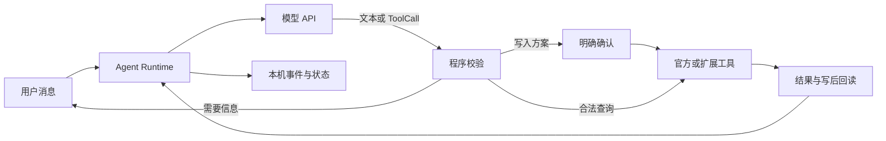

# ToolFlow

**基于真实 Retail 环境的可靠工具调用 Agent：观察、校验、确认、执行、回读与恢复。**

ToolFlow 是一个持续迭代的 LLM Agent 算法工程学习与实验项目。它接入 [τ²-Bench-Verified](https://github.com/amazon-agi/tau2-bench-verified) 的 Retail 模拟环境，支持真实用户多轮交互和官方 Benchmark 编排，探索工具调用失败后的有效反馈、缺失信息补问和重复写入保护。

> **当前状态：开发版本，尚无正式模型效果结论。** 已有离线执行契约测试、有限本地模型交互和云端开发对话验证。完整模型对照、测试集泛化、Policy 违规率和误拦截率尚未系统测量；测试回放通过不等于 LLM 成功率。

## 功能

- **原生 Tool Calling**：本地 Ollama 与云端 OpenAI-compatible Chat Completions。
- **共享 Runtime**：多轮控制台、本机 Web 与官方 Agent 生命周期适配。
- **执行校验**：schema、身份/订单归属、部分明确业务条件、精确参数确认和写后回读。
- **失败恢复**：模型修正与用户补充分流；记录失败身份输入，避免无信息的重复查询。
- **可观察性**：原始模型响应、实际工具轨迹、内部反馈、追加事件与状态快照分别保存。
- **业务扩展**：独立 SQLite 中模拟注册和购买；与官方原始 Retail 模式隔离。
- **对照入口**：官方 LLMAgent、基础安全 Runtime、增强规则、增强规则＋有限恢复。

本项目没有训练、LangChain 或 MCP 运行依赖。PyTorch 不参与训练或前向推理，模型推理由外部服务完成。

## 执行流程



Benchmark 中由官方 Orchestrator 唯一执行工具，Adapter 只生成消息。完整评测依据留在 runner 和 Evaluator，客服 Agent 不接收 evaluation_criteria 或标准动作。

## 安装

需要 Python **3.10+**、Git，以及支持原生工具调用的模型服务。已开发验证的平台为 Windows / Python 3.10，其他平台尚未完成完整验收。

以下是作者本机的 Windows 绝对路径示例。请按自己的安装替换解释器和仓库路径；代码不再强制作者的 Python 路径。可用 `TOOLFLOW_PYTHON` 显式限制解释器。

```powershell
git clone https://github.com/bluexizang/ToolFlow.git 'D:\projectsgit\ToolFlow'
Set-Location -LiteralPath 'D:\projectsgit\ToolFlow'
& 'D:\Scoop\apps\anaconda3\current\App\envs\yolov8\python.exe' -m pip install --target 'D:\projectsgit\ToolFlow\.p0_deps' -r 'D:\projectsgit\ToolFlow\requirements-v1.txt'
& 'D:\Scoop\apps\anaconda3\current\App\envs\yolov8\python.exe' -X utf8 'D:\projectsgit\ToolFlow\tools\setup_upstream.py'
Copy-Item -LiteralPath '.env.example' -Destination '.env'
```

上游版本由 [upstream.lock.json](upstream.lock.json) 固定。获取脚本不覆盖已有不同版本或有改动的工作区。`.p0_deps` 是隔离依赖目录，不上传仓库；请先选择适合自己的隔离环境。固定的是直接依赖，不是所有平台的完整锁文件。

## 模型与 Web

云端模式在本机 `.env` 配置：

```dotenv
TOOLFLOW_CLOUD_BASE_URL=https://your-provider.example/v1
TOOLFLOW_CLOUD_MODEL=your-tool-calling-model
TOOLFLOW_API_KEY=
```

Base URL 不包含 `/chat/completions`。完整配置会自动使网页出现云端选项；启动和配置检查不请求模型，发送消息可能产生供应商费用。兼容接口的推理字段、工具行为和价格统计需要逐供应商验证。

```powershell
& 'D:\Scoop\apps\anaconda3\current\App\envs\yolov8\python.exe' -X utf8 -u 'D:\projectsgit\ToolFlow\run_web.py'
```

打开 `http://127.0.0.1:8765`，选择模型及业务环境后新建对话，确认右侧版本为 `identity_recovery_v2`。

|环境|数据与用途|
|---|---|
|official|每个运行独享官方原始数据库，不包含在扩展模式注册的账号|
|extended|账号、购买和回执保存到 `state/retail_extended.sqlite3`，仅模拟支付，不用于官方 Benchmark|

本地模式可用 `--local-model 模型名:标签` 指定已安装 Ollama 模型。默认标签 `deepseek-v4-9b-heretic:q4_k_m` 是作者的定制安装，仓库不提供或自动下载权重，也不据此认定为官方 DeepSeek 模型。已有服务直接使用；需要启动已有服务时加 `--start-server`，安装位置可由 `.env.example` 的可选变量配置。

控制台示例：

```powershell
& 'D:\Scoop\apps\anaconda3\current\App\envs\yolov8\python.exe' -X utf8 -u 'D:\projectsgit\ToolFlow\run_p1.py' --backend cloud --retail-mode extended
```

控制台支持 `/send`、`/finish`、`/new`、`/status` 和核对单中的 `/confirm`。网页刷新可以接回仍运行的标签页会话；服务重启不会自动迁移聊天内存或续跑写入。

## 验证和评测

离线验收无需 API Key 或 GPU 模型：

```powershell
& 'D:\Scoop\apps\anaconda3\current\App\envs\yolov8\python.exe' -X utf8 -B 'D:\projectsgit\ToolFlow\tools\check_v1.py'
```

验收阻断外部 socket，只允许回环 HTTP。测试使用协议响应 fixture，生产入口不使用这些响应；它们不是模型效果数据。验收材料写入被忽略的 `evidence/`。

只检查官方评测配置，不请求模型：

```powershell
& 'D:\Scoop\apps\anaconda3\current\App\envs\yolov8\python.exe' -X utf8 'D:\projectsgit\ToolFlow\run_benchmark.py' --check-config
```

实际评测需显式 `--run`，同时涉及客服模型和官方用户模拟器。先在 train 开发任务验证接口，再冻结协议开展对照；已经调试的 Task 0 不能作为测试集泛化证据。

默认每个会话/试验角色：480 次模型调用、累计 240 万 tokens、单次输出 8192 tokens、连续修正 10 次。CLI 可覆盖；这是程序检查阈值，不是供应商费用封顶。缺用户信息会正常补问，不消耗模型修正次数。

## 代码导航

|模块|职责|
|---|---|
|run_p1.py / run_web.py|真实用户入口|
|run_benchmark.py / toolflow/benchmark.py|官方编排、评分和对照适配|
|toolflow/model.py / settings.py|模型协议与配置|
|toolflow/runtime.py|会话、决策、交互执行、回读和审计|
|toolflow/validation.py / recovery.py|证据校验、身份状态、确认与错误分流|
|toolflow/commerce.py|注册购买扩展与 SQLite 事务|
|toolflow/web.py|本机 HTTP、会话串行与请求去重|
|tests/|离线契约和回归测试|

官方 Retail 工具、数据、policy、消息类型、用户模拟器、原始 Baseline、Orchestrator 和 Evaluator 来自上游。ToolFlow 的贡献是围绕这些组件的交互、校验和恢复工程，详见 [第三方声明](THIRD_PARTY_NOTICES.md)。

## 当前限制

- 复杂自然语言、否定和数量意图仍可能理解错误；确认单不是完备语义保证。
- 规则只覆盖部分明确 Policy；正式违规率和误拦截率尚未测量。
- 云端费用未知时保持未估算；固定 seed 不保证供应商逐字复现。
- Web 仅为本机演示，没有公网多租户登录或真实支付能力。GitHub Pages 可展示文档，不能直接运行 Python 后端。
- 后续重点是实际模型回归、误拦截标注、固定故障计划和冻结后的 held-out 评测。

[当前状态](docs/project_status.md) · [架构与阅读顺序](docs/system_overview.md) · [开发和隐私边界](docs/development.md)

代码采用 [MIT License](LICENSE)。密钥、原始对话、业务数据库、完整本地核验材料和模型权重不公开。
