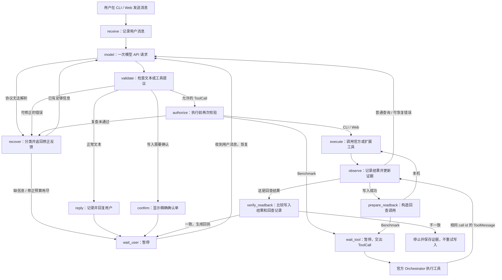

# ToolFlow：沿着一条消息读懂 LangGraph 版

更新：2026-11-19，版本 `langgraph_v1`。目录已整理，CLI 入口为 `run_cli.py`，依赖统一为 `requirements.txt`。

这次直接替换了原来的手写编排循环。你输入一条消息之后，下一步去问模型、校验、执行工具还是停下来等你，现在由 `toolflow/graph.py` 中的图决定。模型服务、零售数据库和业务规则仍是真实的原有实现。

## 1. 先抓住四个概念

**节点（node）就是一个普通 Python 方法。** 例如 `model()` 请求一次模型，`validate()` 检查它的提议，`execute()` 执行一次工具。没有必要先学习整个 LangChain 库。

**状态（state）就是节点之间传递的数据。** 本项目的 `FlowState` 规定了这个字典有哪些字段。节点返回 `{"route": "recover"}`，意思是把状态中的 `route` 更新成 `recover`；其他字段保留。它没有创建新的用户对话。

**边（edge）决定接下来运行哪个节点。** 普通边只有一个方向，例如 `receive → model`。条件边读取刚更新的状态再选择方向，例如校验失败走 `recover`，正常查询走 `authorize`。

**暂停（interrupt）表示图在等外部输入。** `wait_user` 等用户回复，`wait_tool` 等官方编排器返回工具结果。下一次用 `Command(resume=...)` 恢复同一个暂停点，不需要重新执行此前的工具。

LangGraph 提供这些运行机制，但不会替我们知道“这个订单是不是你的”“换货是否需要确认”。这些仍由业务代码判断。

## 2. 文件从哪里开始看

按下面顺序读第一遍，不用先钻进每个工具和所有参数。

|顺序|文件与函数|第一遍要弄清什么|
|---|---|---|
|1|`run_cli.py:main`|读取用户输入后，只调用 `runtime.run_turn()`；外层循环是等人输入，不是 Agent 推理循环|
|2|`toolflow/runtime.py:RetailRuntime.run_turn`|把请求交给同一套图；Runtime 管模型、环境、守卫和日志|
|3|`toolflow/graph.py:ToolFlowGraph.build_graph`|把节点名与真实方法连接起来，看条件边如何形成循环|
|4|`toolflow/graph_state.py:FlowState`|认清 `candidate`、`call`、`response`、`route` 等临时数据|
|5|`toolflow/graph.py:model / validate / observe`|一次模型调用怎样变成一个经过检查的工具调用，又怎样把结果传回模型|
|6|`toolflow/runtime.py:_request` 和 `toolflow/model.py`|模型实际收到哪些历史、工具 schema；原始响应如何解析|
|7|`toolflow/validation.py:RetailGuard`|身份、归属、参数、确认和重复写入的业务边界|
|8|`toolflow/graph.py:confirm / authorize / prepare_readback / verify_readback`|写操作为什么必须经过确认、复查和回读|
|9|`toolflow/recovery.py` 与 `graph.py:recover`|错误反馈怎样进入下一次请求；什么时候应该问用户|
|10|`toolflow/web.py:WebSession.submit`、`toolflow/benchmark.py:BenchmarkAgentAdapter.generate_next_message`|两个入口如何使用同一张图|

`decide()` 和 `execute()` 仍可用于逐步调试和回归测试，但内部也运行这张图。它们没有保留另一套旧循环。正常 CLI、Web 使用 `run_turn()`，官方评测使用图的外部执行模式。

## 3. 总图：用户、模型、工具、数据库



图里 `observe → model → validate → authorize → execute → observe` 这条环，就是 Agent Loop。模型根据历史选择下一步工具，不是我们提前写死“每次都查哪几个工具”。

身份核验、执行前复查、写后回查则是确定的工作流。我们让模型选择业务动作，同时用程序约束动作的执行条件。

## 4. 拿一次查询走一遍

以下是官方模拟数据里的示例，输入为：“我是 Yusuf Rossi，邮编 19122，想换货。”它不是把 Task 标准答案塞给模型的运行方式。

1. `run_cli.py` 读到字符串，调用 `runtime.run_turn(content)`。
2. Runtime 延迟创建 `ToolFlowGraph`。`run_user()` 首轮从 `receive` 开始。
3. `receive()` 调用 `runtime.receive()`。它把用户消息记到 `SessionState.messages` 和 `provider_history`，让 Guard 从真实用户文字中收集身份信息，把会话设为 `running`。
4. `model()` 调用 `_request()`。请求里有系统提示、Retail policy、此前消息、可见工具 schema，以及从真实观察整理出来的可信状态。没有整份数据库，也没有 `evaluation_criteria`。
5. 假设模型提出 `find_user_id_by_name_zip(first_name="Yusuf", last_name="Rossi", zip="19122")`。原始 JSON 存进 `provider/001.response.json`；解析后的提议放进 `FlowState.candidate`。
6. `validate()` 检查工具名、调用 ID 和参数来源。用户确实说了这些身份字段，因而这次查找可执行。
7. `authorize()` 在执行边界再次检查，然后走本机 `execute()`。
8. `execute()` 调用真实 Retail 环境的 `get_response(call)`。零售工具查询本次会话的模拟数据库，返回用户 ID。这一步没有修改订单。
9. `observe()` 按原调用 ID 记录 `ToolMessage`。`guard.observe()` 把身份核验结果记为已观察证据，连续修正计数清零。
10. 边把流程送回 `model()`。下一次 API 请求带上刚才的助手 ToolCall 和工具结果，模型才有依据提出 `get_user_details`，继续查用户的订单和支付方式。
11. 当模型需要用户选择订单或补充换货要求时，返回普通文本。`reply()` 记下文本，状态改为 `waiting_user`。
12. `wait_user()` 调用 `interrupt()`。图的位置存进本次运行的 SQLite；CLI 显示回复，Web 轮询到消息后显示。这里没有一个不断空转调用模型的后台循环。

你再发一条消息时，`run_user()` 用相同线程 ID 和 `Command(resume=...)` 恢复。`wait_user()` 只在恢复后追加这条新消息，然后回到 `model()`。它不会重新执行第 8 步。

## 5. 换货确认与状态修改的子图

```text
已经观察到：身份、订单、支付方式、商品变体与库存
    │
    ├─ 模型：prepare_exchange(精确商品与支付参数)
    │    validate → Guard 生成确认单
    │    confirm → _say → wait_user → interrupt
    │    数据库：未修改；Guard.pending：保存待确认方案
    │
    ├─ 用户明确同意
    │    Command(resume=...) → wait_user → runtime.receive
    │    Guard 核对确认单；下一次模型请求获得精确批准参数
    │
    ├─ 模型：exchange_delivered_order_items(同一组参数)
    │    validate：参数、身份、订单与确认必须匹配
    │    authorize：再次校验最新状态，消耗一次性确认
    │    execute：实际执行一次写入
    │    observe：保存真实结果、更新已观察证据
    │
    ├─ prepare_readback：代码生成 get_order_details(同一订单)
    │    execute → observe → verify_readback
    │    比较真实回查记录与写入返回记录
    │
    └─ 一致：生成有来源标记的模拟回执，等待用户
         不一致 / 写入报错但数据库已变化：停止，禁止盲目重复写入
```

在官方示例换货里，订单状态从 `delivered` 变为 `exchange requested`，并记录换出商品、换入商品、支付方式和差价。它表示模拟系统已经收到换货申请，不表示现实中的快递或退款已经完成。

确认单、补问兜底、写后回执可能由程序生成；普通对话来自模型。`assistant_message` 事件里的 `source` 会区分 `model`、`runtime_confirmation`、`runtime_information_request`、`runtime_verified_receipt`。

## 6. 错误为什么回到模型，什么时候停下来等人

`model()` 只请求一次。`recover()` 也只处理一次错误。两者之间的条件边实现继续尝试，节点里没有隐藏一套推理循环。

|情况|流向|含义|
|---|---|---|
|工具名、格式或参数可以修正|`recover → model`|把结构化错误放进下一次请求，让模型重提|
|身份查无此人，没有其他真实身份输入|结果先进入模型补问；若模型仍调用工具则转 `recover → wait_user`|需要新信息，重复查询不会创造信息|
|模型正常提出补问|`validate → reply → wait_user`|这是正常交互，不是系统失败|
|连续修正达到配置预算|`recover → wait_user`|保留失败原因，暂停当前自动尝试|
|写入错误且数据库变化，或回查不一致|停止|当前结果不确定，不能自动重做写入|

成功工具会清零连续修正次数。默认预算仍为整次会话最多 480 次模型调用、累计 2,400,000 tokens、单次最多输出 8192 tokens、单步骤连续修正 10 次；这次没有调回小预算。模型服务是否支持对应上下文长度仍由供应商决定。

## 7. 两份状态和三种存储，别混在一起

|对象 / 文件|保存什么|如何变化|
|---|---|---|
|内存中的 `SessionState`|完整会话消息、运行状态、调用计数、token、停止原因|Runtime 和图的节点随执行更新|
|内存中的 `RetailGuard`|身份、已读订单/商品、失败身份输入、确认方案和已尝试写入|只根据用户文字与真实观察更新|
|图的 `FlowState`|当前候选、待执行调用、结果、分支、写前哈希、回查目标|每个节点返回局部更新，框架合并|
|`graph.sqlite3`|LangGraph 每步检查点与暂停信息|由框架写入，本地文件不上传|
|`graph_state.json`|最近一次图调用结束/暂停时的可读快照与下一节点|覆盖保存，便于人工查看|
|`graph.mmd`|从实际构建的图导出的 Mermaid 拓扑|图创建时生成|
|`events.jsonl`|模型、校验、恢复、工具及 `graph_node_completed` 事件|逐行追加|
|`messages.json`|Runtime 的官方类型消息快照|每次 checkpoint 覆盖|
|`model_history.json`|下一次请求需要的历史，包括内部修正反馈|每次 checkpoint 覆盖|
|`provider/*.request.json`、`*.response.json`|每次请求和未经 Runtime 改写的模型 JSON 回复|按模型调用序号分别保存|
|`summary.json`、`manifest.json`|状态/计数，以及配置/版本/起始依据|摘要持续覆盖，manifest 初始化写入|
|`final_db.json`|会话关闭时的数据库快照|关闭时写入|
|`state/retail_extended.sqlite3`|扩展模式的注册账号、订单与写回执|业务写入后持久保留|

**聊天历史不等于业务数据库，图检查点也不等于整套业务环境备份。** 官方模式的环境是每个运行独立的内存数据库；扩展业务数据库持久保存。模型 API 每次都由本地组织上下文，没有依赖供应商记住窗口。

**当前限制：不支持进程重启后自动恢复旧会话。** 图检查点已经落盘，但 Guard、确认状态及官方环境还在内存里。只有恢复这些组件并核对写入结果后，才能安全开放重启恢复。不能只加载图检查点就重做一个可能已执行的写节点。`graph_state.json` 明确标注 `restart_resume_supported: false`。

## 8. Benchmark 为什么共用图却不重复执行

官方 `Orchestrator` 要求 Agent 返回 `AssistantMessage`。含 ToolCall 时由它执行环境，然后把 `ToolMessage` 交回来。

`BenchmarkAgentAdapter.generate_next_message()` 只转换输入并调用 `flow.run_user(external=True)` 或 `flow.run_tool()`。它不再自己维护一套写入、回查和恢复分支。

图在 `authorize → wait_tool` 暂停，向官方返回 ToolCall。收到相同 ID 的结果才恢复到 `observe`。写后回查也通过 `wait_tool` 交给官方执行。因此查询、写入和回查均只有一个执行者。

官方 Evaluator 根据 Orchestrator 收集的真实通信轨迹及任务标准评分。评分材料在 runner、离线评测和测试中，Agent 的请求构造没有入口接收标准动作。

官方 LLMAgent 仍作为原有 Baseline 保留，方便与自研图编排方法比较。Baseline 是对照方法，不是旧 Runtime 的第二套产品实现。

## 9. 哪些功能来自框架，哪些仍是我们的工程

LangGraph：StateGraph、节点调度、条件边、检查点、interrupt、Command、执行事件与图导出。

ToolFlow：Retail 模型提示词、API 传输与协议解析、预算、身份与 Policy 检查、精确确认、错误分类、结果回查、业务存储、Web 鉴权/去重、官方 Benchmark 适配。

模型提供商：真正执行推理，返回原生工具调用和 usage。LangGraph 不会使错误工具调用自动变正确；这需要模型能力、准确工具说明、合理规则与可用的纠错反馈一起配合。

## 10. 本机运行与验证

依赖已经装入本项目 `.deps`，没有修改全局 yolov8 环境的安装目录。以后重新安装请使用完整依赖文件：

```powershell
& 'D:\Scoop\apps\anaconda3\current\App\envs\yolov8\python.exe' -m pip install --target 'D:\projectsgit\实习项目1\.deps' --upgrade -r 'D:\projectsgit\实习项目1\requirements.txt'
& 'D:\Scoop\apps\anaconda3\current\App\envs\yolov8\python.exe' -X utf8 -u 'D:\projectsgit\实习项目1\run_web.py'
```

控制台云端模式（使用已有 `.env`，发送消息才会请求模型）：

```powershell
& 'D:\Scoop\apps\anaconda3\current\App\envs\yolov8\python.exe' -X utf8 -u 'D:\projectsgit\实习项目1\run_cli.py' --backend cloud --retail-mode extended
```

不请求真实模型的验收：

```powershell
& 'D:\Scoop\apps\anaconda3\current\App\envs\yolov8\python.exe' -X utf8 'D:\projectsgit\实习项目1\tools\check.py'
```

新增 `tests/test_langgraph.py` 验证真实图路由、多查询循环、用户暂停恢复、错误身份补问、换货确认和一次写入、官方执行权、取消边界及实际 SQLite 检查点。离线响应只替换模型传输边界，不作为生产 FakeModel，也不代表真实模型成功率。

官方资料：[Graph API](https://docs.langchain.com/oss/python/langgraph/graph-api)、[Interrupts](https://docs.langchain.com/oss/python/langgraph/interrupts)、[Persistence](https://docs.langchain.com/oss/python/langgraph/persistence)。本导读描述的是当前仓库实现，未把框架全部能力都说成已经支持。

## 附录：遇到这些 Python 写法时怎么读

`getattr(self, name)`：按字符串取出对象的方法。例如 `name="model"` 时，取到的就是 `self.model` 这个方法，交给框架稍后调用。这里没有括号，所以还没有执行它。

`lambda s: s["route"]`：一个简短函数，收到状态字典 `s` 后返回 `s["route"]`。等价于写一个普通函数，在函数里 `return s["route"]`。条件边会用这个返回值查找下一节点。

`TypedDict`：给字典约定字段的类型，帮助阅读和静态检查；实际运行时仍是字典。`total=False` 表示允许只提供一部分字段，不表示所有字段的值都必须是 False。

`return {"error": None}`：节点只更新 `error` 字段，其他字段仍在。不要理解成把整份图状态清空成一个字段。多个用户轮次之间也因此需要明确重置当前候选和回查标记。

`if TYPE_CHECKING`：只供类型检查工具理解的导入。这里 Runtime 和 Graph 互相使用类型名字，运行时再延迟导入，避免两个模块导入到一半互相等待。

`for update in graph.stream(...)`：读取框架已经完成的节点事件，供 CLI 展示和本地日志记录。下一步运行哪个节点由条件边决定，不是这个 for 循环决定。

`interrupt(...)` 与 `Command(resume=...)`：前者暂停，后者带着外部输入恢复。恢复时暂停节点会从头运行，因此不能把有副作用的写入放在同一个暂停节点的 interrupt 前面。本项目把它们分成不同节点，也没有给工具写入配置自动重试。

`runtime.checkpoint()` 与 LangGraph checkpointer：名字相近，职责不同。前者把业务消息、模型历史、摘要保存成 JSON；后者保存图的执行位置和 FlowState。它们都在本地，但不能互相替代。
